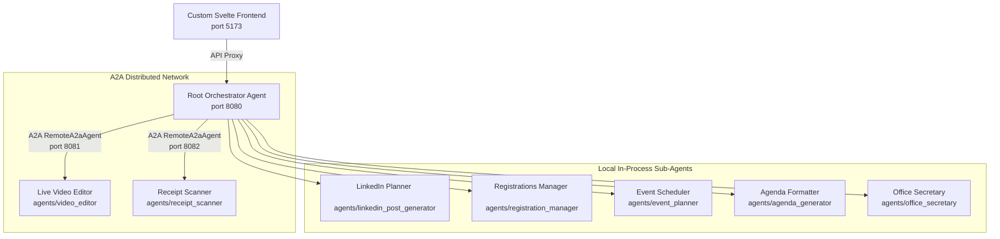

# 🚀 Community Studio - Setup & Operations Guide

Welcome to the comprehensive setup and operations guide for **Community Studio**. This project is a multi-agent orchestration workspace built using the [Google Agent Development Kit (ADK) 2.0](https://adk.dev/) in Python (powered by Vertex AI and Gemini models) paired with a high-performance, responsive **Svelte + Vite** custom frontend.

---

## 🏗️ System Architecture

The project consists of three main layers:



1. **Custom Svelte Frontend (`frontend/`)**: A dark-themed, premium workspace that provides a chat interface, real-time status ticker for the agents, and capability highlights.
2. **Root Orchestrator Agent (`agents/root_agent/`)**: The main coordinating Python agent that receives user requests, determines the correct domain, and delegates tasks to the appropriate specialized sub-agents.
3. **Sub-Agents Core (`agents/`)**: Seven specialized sub-agents covering receipts/expense reporting, speaker video generation, social media management, guest lists, meetup scheduling, agenda formatting, and office access letters.

---

## 📋 Prerequisites

Ensure you have the following installed on your machine:
* **Python 3.12+** (to run ADK and agent packages)
* **uv** (to manage Python dependencies)
* **Node.js v22+** (to run the custom Svelte frontend and the HyperFrames render server)
* **FFmpeg** (strongly recommended, used for video rendering and processing tasks)
* **Google Cloud SDK / CLI** (for Vertex AI authentication)

---

## 🛠️ Step-by-Step Setup

Follow these steps to set up both the backend and frontend environments.

### 1. Python Environment (Backend)

Synchronise the locked backend dependencies:

```bash
uv sync --locked
```

### 2. Node.js Environment (Frontend & Video Editor)

Install the Node packages for both the Svelte workspace and the rendering engine:

```bash
# Install Svelte UI dependencies
cd frontend
npm install
cd ..

# Install HyperFrames rendering dependencies
cd agents/video_editor
npm install
cd ../..
```

### 3. Vertex AI Authentication (only for Vertex mode)

If `GOOGLE_GENAI_USE_VERTEXAI=1`, authenticate your local environment with Google Cloud to grant Vertex AI API access:

```bash
bash <(curl -sSL https://storage.googleapis.com/cloud-samples-data/adc/setup_adc.sh)
```
*Provide your GCP Project ID (e.g., `gdg-agents-496611`) when prompted and complete authentication in your browser. When using `GOOGLE_GENAI_USE_VERTEXAI=0`, skip this step and configure `GOOGLE_API_KEY` instead.*

### 4. Configuration Settings (.env)

The system uses a **single unified `.env` file** located in the project root directory. All agents, A2A microservices (Video Editor, Receipt Scanner), and test suites automatically read from this root file. You can use the template [.env.example](../.env.example) to create it:

```bash
# Copy the example configuration to .env
cp .env.example .env
```

Open `.env` and configure the following parameters:
- `GOOGLE_API_KEY`: Your preferred API key from [Google AI Studio](https://aistudio.google.com/). It is used when `GOOGLE_GENAI_USE_VERTEXAI=0`; all Gemini model calls then use this key instead of Vertex credentials.
- `GEMINI_API_KEY`: Backwards-compatible fallback when `GOOGLE_API_KEY` is not configured.
- `GOOGLE_GENAI_USE_VERTEXAI`: Set to `1` to run Gemini calls through Vertex AI endpoints, or `0` to run Gemini calls through the Gemini Developer API. In API mode, `GOOGLE_API_KEY` or `GEMINI_API_KEY` must be set.
- `GOOGLE_CLOUD_PROJECT`: Your GCP Project ID from [Google Cloud Console](https://console.cloud.google.com/).
- `GOOGLE_CLOUD_LOCATION`: The GCP region/location for Vertex AI model inference (use `global` for optimal multi-region availability across Gemini models; Veo video generation automatically routes to `us-central1`).
- `GOOGLE_DRIVE_FOLDER_ID`: The ID of your target Google Drive folder (found in the folder's URL).
- `VIDEO_ENGINE`: Video generation engine — set to `veo` (Vertex AI Google Veo 3.1) or `omni` (Google AI Gemini Omni Flash preview via Interactions API). API mode requires `omni`; `veo` is rejected because it requires Vertex AI.
- `ENABLE_VIDEO_GENERATION`: Set to `true` to run live AI video animation, or `false` for layout-only dry-runs using local placeholder media.
- `RENDER_4K`: Set to `true` to render high-resolution 4K Ultra-HD MP4 compositions.
- `RENDER_ORDINARY`: Set to `true` (default) to render 1080p Full-HD MP4 compositions.
- `RENDER_GIF`: Set to `true` (default) to generate animated GIF previews via FFmpeg.

> [!TIP]
> **Unified Configuration**: Avoid placing separate `.env` files inside individual subdirectories (`agents/root_agent/`, `agents/receipt_scanner/`, etc.). The workspace root `.env` serves as the single source of truth for all microservices.

### 5. Customizing the Expense Report Google Doc Template

The **Receipt Scanner** sub-agent compiles reports by copying a Google Doc template and populating placeholders. By default, it uses a shared, read-only template.

To customize the report template (e.g., adding your own styling, custom tables, headers, or organizational details):
1. Open the default template: [Google Docs Template](https://docs.google.com/document/d/1nkT3N6ovmmBJYDK9S9oRRaOZ6sCQkAwve58y7sS2eOw/edit).
2. Create a copy of it in your own Google Drive (**File -> Make a copy**).
3. Modify the copied document as you like (keep the existing placeholder tags like `{{APPROVED}}` and `{{EXPENSES_TABLE}}` where you want the dynamic content to be inserted).
4. Extract the Document ID from the URL of your new document (e.g., `https://docs.google.com/document/d/<YOUR_DOCUMENT_ID>/edit`).
5. Open the local file [Expense_report_template.gdoc](../agents/receipt_scanner/assets/Expense_report_template.gdoc) and replace the `"doc_id"` value with your new document ID:
   ```json
   {
     "doc_id": "YOUR_NEW_DOCUMENT_ID",
     "resource_key": ""
   }
   ```

---

## 🚀 Running the Entire Project

To run the complete system with the custom Svelte frontend talking to the ADK backend agent, you need to spin up two processes in separate terminal sessions:

### Terminal 1: Launch Backend (ADK FastAPI Server)

The backend agent server must run on port `8080` (as Vite is configured to proxy all API requests to `127.0.0.1:8080`).

```bash
# Run the full ADK workspace so each agent is addressable directly.
# This exposes root_agent plus all specialized sub-agents in /list-apps.
uv run --locked adk web --port 8080 agents
```

### Terminal 2: Launch Frontend (Svelte Dev Server)

```bash
cd frontend
npm run dev
```
*This starts the Vite server (typically at `http://localhost:5173`).*

### Open the Application

Now, open your browser and navigate to:
👉 **[http://localhost:5173](http://localhost:5173)**

Here you will find the **Advanced Agentic Workspace** where you can select the active agent, start new chat sessions, type requests, and drag-and-drop receipts or participant rosters directly.

---

## 🛠️ Alternative & Diagnostic Operations

### 1. Using the Default ADK Developer UI
If you want to use the default web playground provided out-of-the-box by ADK:
```bash
uv run --locked adk web --port 8000 agents
```
Open **`http://localhost:8000`** in your browser.

### 2. Testing Receipt Scanner via CLI
You can test the receipt OCR scanner and currency converter directly using the test runner:
```bash
uv run --locked python tests/test_receipt_scanner.py
```

### 3. HyperFrames Development & Preview Sandbox
To preview the video composition layout, debug GSAP timelines, or check visual spacing:
```bash
# Run local dev server with hot-reload and visual preview (scrub timeline at http://localhost:3000)
npm run video:dev

# Run linter, Chrome validation and layout checks
npm run video:check

# Render composition to an MP4 video file locally
npm run video:render
```

---

## 🧹 Code Quality & Formatter

Before pushing any Python updates, make sure your code aligns with our Ruff styling guidelines (line-length is capped at `120` characters):

```bash
# Format Python files
ruff format .

# Check for lint errors and warnings
ruff check .

# Apply auto-fixes
ruff check --fix .
```
